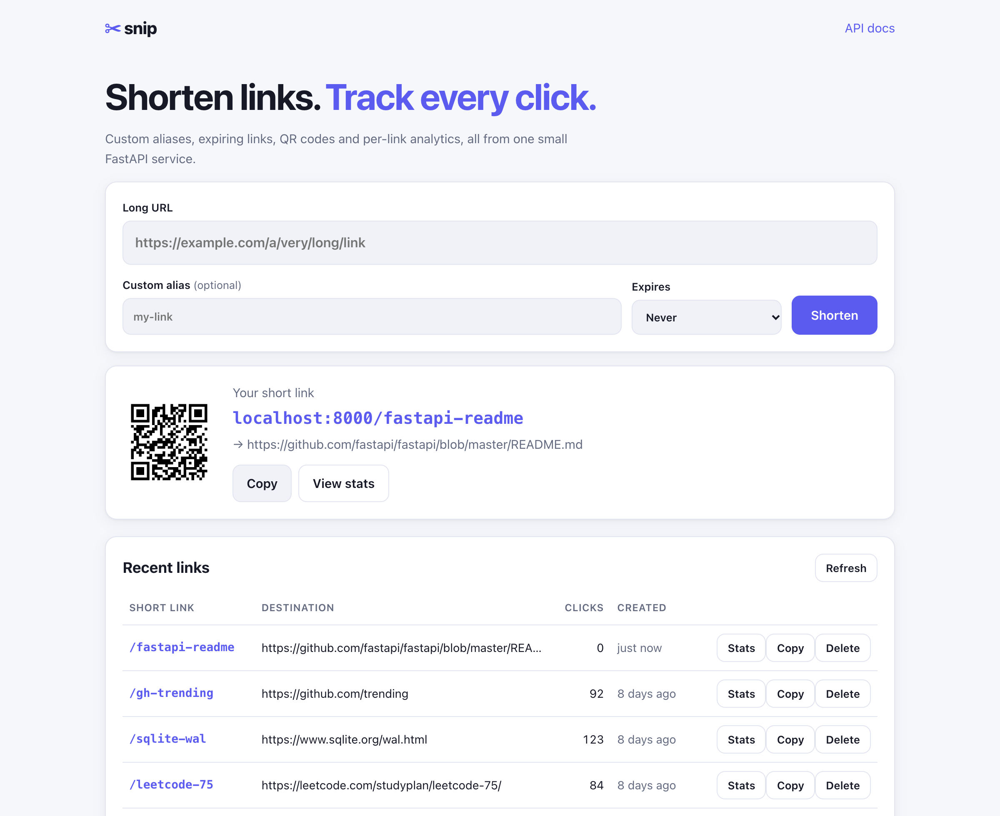
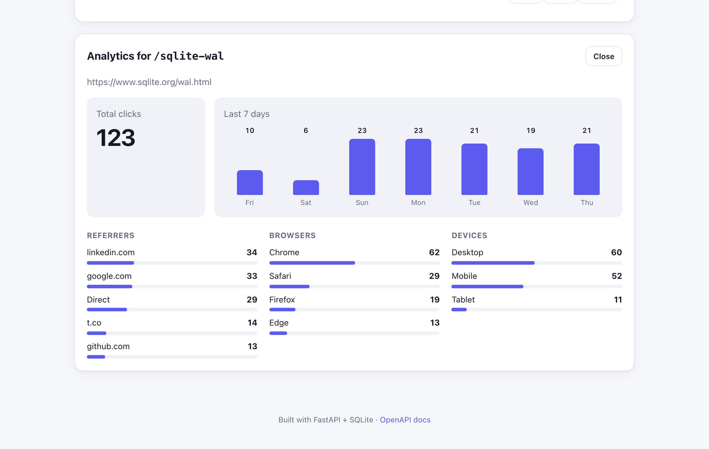

# ✂ Snip: URL Shortener with Click Analytics

[](https://github.com/pMag11-alt/snip-url-shortener/actions/workflows/ci.yml)


A URL shortener in the style of bit.ly. Each short link gets a QR code, an optional custom alias and an optional expiry date.
Every click is recorded, and a dashboard shows traffic for the last 7 days with breakdowns by referrer, browser and device.

The backend is a REST API built with **FastAPI** and **SQLite** (no external database to install). The frontend is plain
HTML/CSS/JavaScript served by the same app. A test suite runs in CI and the service ships as a Docker image.





## Features

- **Short links**: random 6-character base62 codes (≈56.8 billion combinations) or a custom alias such as `/my-resume`
- **Expiring links**: links can expire after 1–365 days; expired links return `410 Gone`
- **Click analytics**: total clicks, a 7-day histogram, top referrers, browsers and devices
- **QR codes**: an SVG QR code for every short link
- **Rate limiting**: a sliding-window limiter caps link creation per client IP (`429` with a `Retry-After` header)
- **Input safety**: only `http(s)` URLs are accepted, reserved paths can't be used as aliases, and links back to the shortener itself are refused
- **Auto-generated API docs**: Swagger UI at `/docs` and ReDoc at `/redoc`
- **Tested & containerised**: 23 pytest tests, GitHub Actions CI on Python 3.11 and 3.13, and a Docker image that is smoke-tested in CI

## Quick start

**Requirements:** Python 3.11+

```bash
git clone https://github.com/pMag11-alt/snip-url-shortener.git
cd snip-url-shortener
./run.sh
```

Open **http://localhost:8000**. `run.sh` creates a virtualenv, installs dependencies, loads a few demo links with a
week of click history, and starts the server.

<details>
<summary>Manual setup (Windows / step by step)</summary>

```bash
python -m venv .venv
# macOS/Linux:  source .venv/bin/activate
# Windows:      .venv\Scripts\activate
pip install -r requirements.txt
python -m app.seed              # optional: demo data
uvicorn app.main:app --reload
```
</details>

<details>
<summary>Run with Docker</summary>

```bash
docker build -t snip .
docker run -p 8000:8000 -v snip-data:/data snip
```
</details>

### Configuration

| Variable          | Default   | Description                                   |
|-------------------|-----------|-----------------------------------------------|
| `SNIP_DB_PATH`    | `snip.db` | Path of the SQLite database file              |
| `SNIP_RATE_LIMIT` | `30`      | Links a single IP may create per minute       |

## API

| Method   | Endpoint                  | Description                                          |
|----------|---------------------------|------------------------------------------------------|
| `POST`   | `/api/links`              | Create a short link `{url, alias?, expires_in_days?}` |
| `GET`    | `/api/links?limit=20`     | List the most recent links with click counts         |
| `GET`    | `/api/links/{code}`       | Get one link                                         |
| `DELETE` | `/api/links/{code}`       | Delete a link and its click history                  |
| `GET`    | `/api/links/{code}/stats` | Analytics: totals, 7-day histogram, breakdowns       |
| `GET`    | `/api/links/{code}/qr`    | QR code as SVG                                       |
| `GET`    | `/{code}`                 | Redirect (302) to the target URL and record a click  |
| `GET`    | `/health`                 | Health check                                         |

```bash
curl -X POST localhost:8000/api/links \
  -H 'Content-Type: application/json' \
  -d '{"url": "https://github.com/fastapi/fastapi", "alias": "fastapi", "expires_in_days": 30}'
```

```json
{
  "code": "fastapi",
  "short_url": "http://localhost:8000/fastapi",
  "target_url": "https://github.com/fastapi/fastapi",
  "created_at": "2026-10-22T18:03:27+00:00",
  "expires_at": "2026-11-21T18:03:27+00:00",
  "clicks": 0
}
```

## How it works

```
Browser ──► FastAPI router ──► SQLite
              │                 ├── links  (code UNIQUE, target_url, created_at, expires_at)
              │                 └── clicks (link_id → links ON DELETE CASCADE, clicked_at,
              │                             referrer, browser, device)   INDEX(link_id, clicked_at)
              └── static/ (vanilla JS dashboard)
```

Design decisions worth calling out:

- **Collision handling.** Codes come from Python's `secrets` module. The database's `UNIQUE` constraint, not a
  "check then insert" query, decides whether a code is free. If two requests race for the same code, one insert fails
  with `IntegrityError` and the app retries with a fresh code. A custom alias that is already taken returns `409 Conflict`.
- **302, not 301.** Browsers cache permanent (301) redirects and skip the shortener on later visits, so those clicks
  would never be counted. A 302 sends every click through the server.
- **Analytics in SQL.** The stats endpoint uses `GROUP BY` queries backed by a composite index on
  `(link_id, clicked_at)`, so the 7-day histogram is an index range scan rather than a full table scan.
- **Sliding-window rate limiting.** Each client has a deque of request timestamps. Timestamps older than the window are
  dropped and the request is allowed if fewer than *N* remain. This avoids the burst a fixed window allows at its boundary.
  ([`app/ratelimit.py`](app/ratelimit.py))
- **Privacy-light tracking.** Only the referrer *domain* and a coarse browser and device class are stored, never the
  full User-Agent string or the IP address.

## Project structure

```
app/
├── main.py         # FastAPI app factory + all routes
├── db.py           # SQLite schema and connection helpers
├── schemas.py      # Pydantic request/response models
├── shortcode.py    # base62 code generation + alias validation
├── ratelimit.py    # sliding-window rate limiter
├── useragent.py    # browser/device/referrer parsing
├── seed.py         # demo data (python -m app.seed)
└── static/         # dashboard: index.html, app.js, styles.css
tests/              # pytest suite (API + unit tests)
```

## Running tests

```bash
pip install -r requirements-dev.txt
pytest
```

## Ideas for extension

- User accounts (JWT) so each user sees only their own links
- Redis cache in front of the redirect lookup, plus a Redis-backed rate limiter for multi-instance deployments
- PostgreSQL via SQLAlchemy for production deployments
- Geo-IP country breakdown

## License

[MIT](LICENSE)
